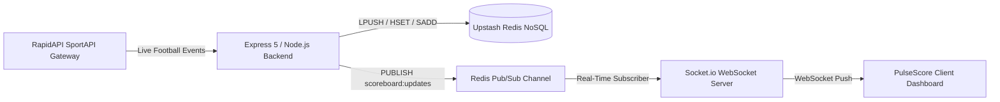

# ⚡ PulseScore — Real-Time Live Sports Scoreboard & NoSQL Intelligence Engine

A high-performance, broadcast-grade live football scoreboard and telemetry intelligence dashboard powered by **Upstash Redis NoSQL**, **Socket.io WebSocket streams**, and authenticated **RapidAPI SportAPI** integration.

---

## 📌 Project Overview

PulseScore solves the challenge of handling ultra-low-latency sports incident updates at scale. Traditional relational SQL databases suffer from significant read/write locking overhead and connection exhaustion during live event spikes. 

PulseScore utilizes an **In-Memory NoSQL Architecture (Redis)** to deliver:
- **Sub-millisecond reads ($O(1)$)** for live scoreboards.
- **Strictly deduplicated incident ledgers** with zero repeat events.
- **Event-driven push updates** via Redis Pub/Sub directly to client WebSockets without wasteful client polling.

---

## 🏛️ System Architecture



---

## 🗄️ Redis NoSQL Data Structures & Big-O Complexity

PulseScore leverages **6 primary Redis data structures**, each intentionally chosen for its exact access pattern:

| Redis Structure | Key Pattern | Time Complexity | Purpose & Role |
| :--- | :--- | :--- | :--- |
| **HASH** | `match:<id>:state` | $\mathcal{O}(1)$ | **Live Match State Cache**: High-speed retrieval of current scores, active period, and participating team metadata. |
| **LIST** | `match:<id>:events` | $\mathcal{O}(1)$ push, $\mathcal{O}(N)$ read | **Chronological Event Stream**: Append-only log (`LPUSH`) storing verified match incidents (goals, substitutions, yellow/red cards). |
| **SORTED SET (ZSET)** | `match:<id>:events_by_time` | $\mathcal{O}(\log N)$ | **Temporal Secondary Index**: Scores event IDs by Unix timestamp for time-range lookups, match replays, and filtering. |
| **SET** | `match:<id>:processed` | $\mathcal{O}(1)$ | **Strict Idempotency Ledger**: `SADD` and `SISMEMBER` checks ensure duplicate API packets never re-trigger score updates or alerts. |
| **HASH COUNTERS** | `match:<id>:stats` | $\mathcal{O}(1)$ | **Atomic Aggregation**: Real-time atomic score tallies via `HINCRBY` (`goals:home`, `goals:away`, incident ratios). |
| **PUB/SUB** | `scoreboard:updates` | $\mathcal{O}(1) + \mathcal{O}(M)$ | **Event Bus**: Global message dissemination broadcasting live incidents instantly across all connected clients. |

---

## 🚀 Getting Started

### 1. Prerequisites
- **Node.js** (v18 or higher)
- **npm** (v9 or higher)
- A free **Upstash Redis** account ([upstash.com](https://upstash.com))
- A free **RapidAPI SportAPI** key ([rapidapi.com](https://rapidapi.com))

### 2. Installation
Clone the repository and install dependencies:
```bash
git clone https://github.com/YOUR_USERNAME/pulsescore.git
cd pulsescore
npm install
```

### 3. Environment Setup
Copy the example environment file:
```bash
cp .env.example .env
```
Fill in your credentials in `.env`:
```ini
SPORTS_API_KEY=your_rapidapi_sportapi_key
SPORTS_API_HOST=sportapi7.p.rapidapi.com

UPSTASH_REDIS_REST_URL=https://your-database.upstash.io
UPSTASH_REDIS_REST_TOKEN=your_upstash_token

MATCH_ID=17022238
PORT=3000
```

### 4. Running the Application
Start the real-time server:
```bash
npm start
```
Open your browser and navigate to:
```
http://localhost:3000
```

---

## 🧪 Verification & Testing Commands

To verify individual components of the system:

```bash
# Verify real RapidAPI SportAPI connection & check quota remaining
npm run check-api

# Inspect current Redis match states and event counts
npm run check-redis
```

---

## 📡 REST API Documentation

| Endpoint | Method | Description |
| :--- | :--- | :--- |
| `/api/live-matches` | `GET` | Returns active verified matches cached in Redis with live status. |
| `/api/select-match` | `POST` | Dynamically switches active match in Redis and Socket.io stream. |
| `/api/matches/:id/events` | `GET` | Fetches the complete chronological event stream for a match. |
| `/api/matches/:id/stats` | `GET` | Returns atomic increment counters from `match:<id>:stats`. |
| `/api/matches/:id/nosql-inspect` | `GET` | Full inspection of all 6 Redis keys and data types for the active match. |
| `/api/sportapi/status` | `GET` | Verifies RapidAPI live connection, latency, and monthly quota remaining. |
| `/api/sportapi/sync-live` | `POST` | On-demand fetch of fresh live matches from SportAPI with quota-guard cooldown. |

---

## 🎨 UI & Dashboard Features

- **Stadium Arena Backdrop:** Illuminated arena background with lawn cut stripes, midfield line, and center circle.
- **Glassmorphism Match Cards:** High-contrast broadcast cards with metallic team badges, live pulse beacons, and digital score pills.
- **Interactive NoSQL Inspector:** In-app inspection tab that displays exact Redis keys, data types, CLI commands (`HGETALL`, `LRANGE`), and architectural roles.
- **API Proof Modal:** Live latency counter, HTTP 200 OK verification, and real-time quota tracking.

---

## 📄 License
This project is licensed under the MIT License.
